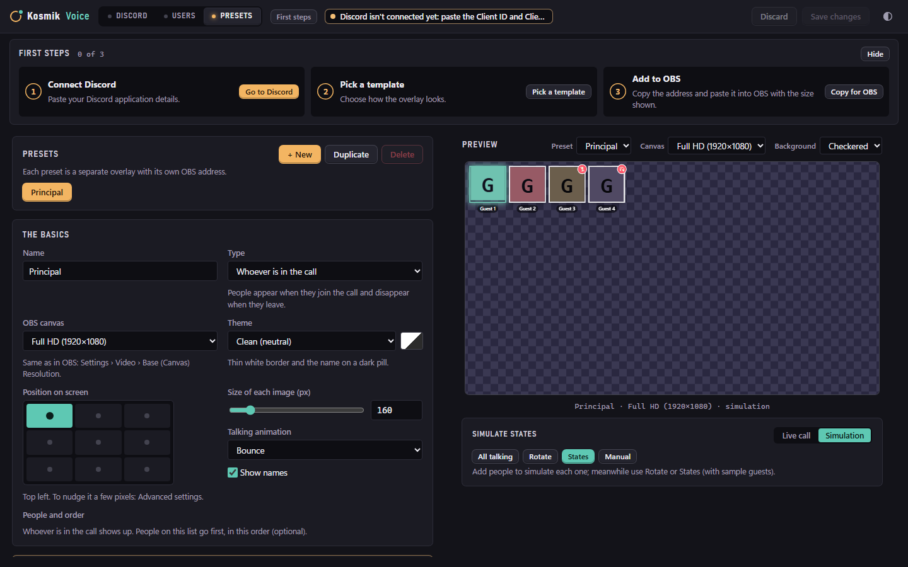

# Kosmik Voice

**Show who's talking in your Discord call, right on your stream.**

A free Discord voice overlay for OBS. Everyone in your voice channel appears on screen with their avatar or a picture you choose, and it reacts when they talk, mute or deafen. Set it up once in a simple web page; after that it just follows whatever call you're in.



- **Your own pictures**, or just Discord avatars. A different image for talking, idle, muted and deafened, so PNGtuber-style setups work too.
- **Ready-made looks**: a row at the bottom, a column on the side, a squad grid, speech bubbles, only whoever is talking… pick a template and adjust it.
- **Five styles**: Clean, Pixel café, Neón, Cómic / sticker and Glass.
- **Nicknames on screen** instead of Discord names, if you like.
- **Live preview** in the editor that can fake a call, so you can design it without anyone online.
- **Private and free.** It runs on your PC and talks to your own Discord app. No bot joins your call and nothing is uploaded anywhere.

The editor is in Spanish or English and comes in three looks (Studio, Daylight, Pixel), shared with [Kosmik Layouts](https://github.com/kosmik-code/kosmik-layouts).

## What you need

- Windows with the Discord desktop app open.
- [Node.js](https://nodejs.org/) 22 or newer (the LTS download is fine).
- OBS (any recent version).

## Install

Download this project (green **Code** button → *Download ZIP*, then unzip it, or `git clone https://github.com/kosmik-code/kosmik-voice`). Open a terminal in its folder and run:

```powershell
npm install
npm start
```

Then open the editor at **<http://127.0.0.1:7429/editor/>**. Keep that terminal open while you stream; closing it stops the overlay.

## Set it up

The editor's **First steps** walk you through these three, and tick them off as you go.

### 1. Connect Discord (one time, about 5 minutes)

Discord only lets you read your own voice channel through an app you own, so you create a small one. It's free and nobody else sees it.

1. Go to <https://discord.com/developers/applications> → **New Application**. Any name works.
2. Open **OAuth2**. Copy the **Client ID** and the **Client Secret** (press *Reset Secret* if it's hidden).
3. Still in **OAuth2**, under **Redirects**, add `http://127.0.0.1` and press **Save Changes**.
4. In the editor's **Discord** tab, paste both and press **Save and connect**.
5. Discord asks for permission. Accept, and the status turns green.

If something goes wrong, the Discord tab says what happened in plain words and what to do about it.

### 2. Pick a look

In **Presets**, pick a template, then change the style, size, position and animation. The preview on the right shows the result. Under **Users** you can give people their own pictures and nicknames.

### 3. Add it to OBS

1. Press **Copy for OBS**. Next to the button you'll see the width and height to use.
2. In OBS: **Sources → + → Browser**. Paste the address and type that width and height.
3. Join a voice call. That's it.

Changes you save in the editor show up in OBS straight away; no need to refresh anything.

## Good to know

- **Kosmik Voice must be running while you stream.** A desktop shortcut that runs `npm start` works well.
- **Several overlays:** each preset has its own OBS address, so you can have a bottom row in one scene and a big grid in another.
- **Positioning without a call:** add `?demo=1` to the end of the overlay address in OBS to see sample people while you place it.
- **Updates:** when there's a new version, the editor shows a banner. Close the app, download the new version (or `git pull`) and start it again. Your settings and pictures in the `data` folder are kept.
- **The overlay stays blank in OBS?** Start Kosmik Voice before opening OBS, or tick *Refresh browser when scene becomes active* in the source's properties.

---

## Technical details

### How it connects

Kosmik Voice talks to the Discord desktop client through **local RPC**, the same channel StreamKit uses. Discord only lets an application's owner and its testers use local RPC, which is why you register your own app. The overlay pages get updates from the local server over a WebSocket.

About the redirect: without a registered redirect, Discord answers the authorization with `Missing "redirect_uri" in request`. The app must not send a redirect itself, because Discord rejects that with `Redirect URI cannot be used in the RPC OAuth2 Authorization flow`. If authorization fails, the app stops retrying, so Discord doesn't show one popup after another. The raw error is under *Technical details* in the Discord tab. Fix the cause, then press **Save and connect** to retry.

The secret and the tokens are stored in `data/secrets.json` and never sent to the browser. To start over, use **Log out of Discord** in the editor or delete that file.

### Features in depth

- **Two kinds of overlay.** *Reactive*: everyone in the channel shows up and the picture swaps while they talk. *Slots*: each person has a fixed place, which shows `OFFLINE` while they're away.
- **Images** per user for idle, talking, muted and deafened (PNG, GIF, WebP, JPG). A missing image falls back to the next one, ending at the live Discord avatar. Images are local files, so their URLs never expire.
- **Talking animations**: bounce, shake, pulse or none. Optional glow, dimming while silent, dimming while muted, and mute/deafen badges. Animations always play in OBS, even when Windows has *Animation effects* turned off. A pause shorter than 300 ms doesn't count as silence, so the animation and glow don't flicker mid-sentence.
- **Theme colours** (*Advanced settings › Theme colours*): frame, image background, name text, name background, name outline and accent. Leave one empty to keep the theme's own; use 8-digit hex such as `#00000000` for transparent. The Neón stripe beside the name can be turned off. Glass uses translucent fills, not a blur of other OBS sources.
- **Names, roles and role colours.** Row, column or grid layouts with alignment, offsets, gap, padding and size.
- **Aliases** per user, or typed straight next to whoever is in your call (**Users › In the call now**), which also adds the person. An empty alias falls back to the Discord name.
- **Templates**: bottom row, side column, squad grid, PNGtuber solo, only whoever talks, bubbles, vertical, blank, Neón row, stickers and glass cards. Pick your OBS canvas in the gallery and sizes are scaled for it.
- **Canvas per preset**: Full HD 1920×1080, 2K 2560×1440, HD 1280×720 or Vertical 1080×1920. It drives the preview and the size the editor tells you to type in OBS; the overlay itself fills whatever size OBS gives it.
- **Limits**: up to 20 presets (one OBS address each), 50 users, and 25 users per preset.
- **Editor**: Spanish or English, and three looks (Studio, Daylight, Pixel), both under the round button at the top right. The language follows your browser the first time. Both choices are remembered per browser and never touch your settings or overlays. The preview can simulate a call: per-user states, everyone talking, a rotating speaker, or all states at once.

### Overlay and editor URL options

| Option | Where | What it does |
|---|---|---|
| `?demo=1` | overlay | Sample people that talk, to position it in OBS without a call |
| `?demo=static` | overlay | Sample people, no movement |
| `?debug=1` | overlay | Shows the connection status |
| `&bg=busy` / `&bg=404850` | overlay, with demo | A colourful test background or a hex colour, for contrast checks. Leave it out in OBS to keep the source transparent |
| `?preset=<id>` | editor | Opens that preset |
| `?gallery=1` | editor | Opens the template gallery |
| `?look=studio\|daylight\|pixel` | editor | Picks the editor look |

### Configuration

Everything is edited in the browser and stored in `data/config.json`. The file is validated before it's written: invalid values are rejected with the field that's wrong, and the previous file stays intact. If the file gets corrupted by hand, it's moved aside to `config.broken-<time>.json` and defaults are loaded. Uploaded images live in `data/assets/`; an image still used by a user can't be deleted.

Environment variables: `KV_PORT` (default `7429`), `KV_DATA_DIR` (default `./data`) and `KV_UPDATE_CHECK` (`0` turns off the update check).

### Updates

On every start, Kosmik Voice checks in the background whether this repository has something newer than your copy. If it does, the console says so and the editor shows a banner linking to the changes. *Hide* dismisses it until a newer update appears. Without a network connection nothing is shown and the app works as usual. A copy downloaded as a zip (no `.git` folder) compares the `version` in `package.json` instead. After an update, open overlays reload themselves.

### Security

- The server listens on `127.0.0.1` only.
- The only outbound request besides Discord is the update check: one anonymous call to the GitHub API per start, carrying only the commit id of your copy. `KV_UPDATE_CHECK=0` turns it off.
- Every request must carry a `127.0.0.1:<port>` or `localhost:<port>` Host header, which blocks DNS rebinding.
- Every change needs a same-origin `Origin` header, and JSON bodies need `Content-Type: application/json`, so other websites can't change your config.
- The WebSocket refuses foreign origins, so other websites can't read who is in your call.
- Uploads are checked by content (magic bytes), capped at 10 MB and renamed safely. Static routes refuse path traversal.

### Development

```powershell
npm test
```

| Path | Role |
|---|---|
| `src/discord/ipc.js` | Discord IPC framing, handshake and requests |
| `src/discord/auth.js` | OAuth: AUTHORIZE → token exchange → AUTHENTICATE, refresh, secret store |
| `src/discord/voice.js` | Reduces RPC voice events into a snapshot |
| `src/discord/service.js` | Reconnects, follows the selected channel, re-subscribes on switch |
| `src/config.js` | Config schema, validation and atomic store |
| `src/server.js` | HTTP + WebSocket server and its guards |
| `public/shared/model.js` | Pure tile model and demo voice, shared by the overlay and the editor |
| `public/overlay/` | OBS overlay page and themes |
| `public/editor/` | Web editor (`logic.js` is pure and tested) |
| `public/editor/kosmik-ui.*` | Look shared with Kosmik Layouts (keep both copies identical) |

The tests use a fake Discord IPC server that speaks the real protocol. Authorization and voice events have also been checked by hand against a real Discord client. If Discord changes a payload, the place to adjust is `src/discord/voice.js`.

Optional browser checks on Windows: `node scripts/check-themes.mjs` starts an isolated local server and headless Microsoft Edge, checks all five themes and saves screenshots under `data/theme-checks/`. It doesn't use your Discord credentials or config. `KV_EDGE` sets a custom Edge executable and `KV_SCREENSHOTS` a different screenshot folder.

## License

[MIT](LICENSE) © 2026 Kosmik
